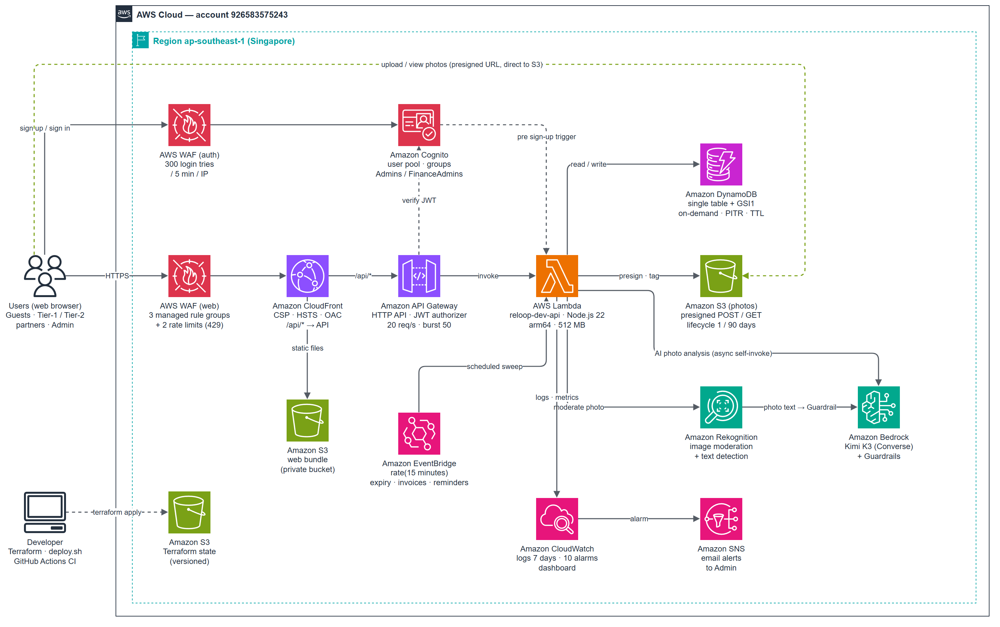

# RELOOP
## Chợ đồ điện tử cũ, hỏng có AI hỗ trợ, xây dựng serverless trên AWS

### 1. Tóm tắt điều hành

ReLoop là chợ trên web, nơi người dùng tại Việt Nam bán thiết bị điện tử cũ hoặc hỏng (điện thoại, laptop, màn hình, linh kiện) cho tiệm sửa chữa, người thu mua và đơn vị tái chế gần mình. Dự án do **AWSS3nt1n4L**, nhóm 5 người thuộc chương trình AWS First Cloud Journey (FCAJ) tại TP. Hồ Chí Minh, xây dựng trong 12 tuần thực tập (14/09–04/12/2026).

Người bán tải ảnh lên, Amazon Bedrock tự điền sẵn thông tin tin đăng. Sau đó tin được gửi tới mọi đơn vị thu mua đã được duyệt có vùng phục vụ của chi nhánh (1–15 km) bao phủ vị trí người bán. Giao dịch chốt bằng báo giá của đơn vị thu mua hoặc bằng giá hai bên thỏa thuận trong chat.

Ngày 08/11/2026, môi trường dev có 14 tài khoản, 12 tin đang mở của 7 người bán và khoảng 31.000 request API trong tháng đầu. Thiết kế serverless mở rộng được mà không phải làm lại kiến trúc: giới hạn Lambda chạy song song đã được duyệt tới 1.000.

Các dịch vụ chính gồm CloudFront, AWS WAF, API Gateway, Lambda, DynamoDB, S3, Cognito, Rekognition, Bedrock, EventBridge, CloudWatch và SNS.

Khách xem Chợ không cần tài khoản. Người đã đăng nhập được chat và mua. Chỉ đối tác được Admin duyệt mới được bán, và chỉ Admin cùng Admin tài chính được kiểm duyệt nội dung và xử lý hóa đơn.

#### Thành viên nhóm

| Thành viên | Vai trò |
|---|---|
| Kung Cẩm Thành | Trưởng nhóm (Team Lead) |
| Hoàng Quốc Việt | Trưởng kỹ thuật (Tech Lead) |
| Trần Hoàng Quốc Trung | Kỹ sư Backend |
| Nguyễn Duy Quang | Kỹ sư Frontend |
| Nguyễn Anh Kỳ | An ninh mạng / Tài liệu |

### 2. Tuyên bố vấn đề

#### Vấn đề hiện tại

Theo Global E-waste Monitor 2024 (UNITAR/ITU), năm 2022 thế giới thải ra 62 triệu tấn rác điện tử, nhưng chỉ 22,3% được thu gom và tái chế chính thức. Cũng theo báo cáo này, Việt Nam thải ra khoảng 516.000 tấn (≈5,3 kg mỗi người) năm 2022.

Người có thiết bị cũ hoặc hỏng thường không biết ai nhận và thiết bị đáng giá bao nhiêu. Hiện họ đăng lên các trang rao vặt chung hoặc nhóm mạng xã hội, tự mô tả thiết bị, gọi từng tiệm, và nhiều khi không ai trả lời.

Các chợ chung như Chợ Tốt hay Facebook Marketplace làm cho mọi loại hàng, nên không có:

- Ghép tin với những tiệm có vùng phục vụ bao phủ người bán.
- Giá dự kiến tính theo bảng giá của chính bên mua.
- Hồ sơ uy tín ghi nhận bên mua giữ đúng báo giá.

Tiệm sửa chữa nhỏ gặp khoảng trống tương tự từ phía bên kia: không có kênh rẻ để nhận đúng loại thiết bị mình thu mua ở gần.

#### Giải pháp

ReLoop chạy toàn bộ luồng trên dịch vụ AWS được quản lý, không có máy chủ nào phải vận hành.

- **Nhận dữ liệu (Ingestion):** trình duyệt tải tối đa 6 ảnh mỗi tin (JPEG/PNG/WebP, tối đa 5 MB mỗi ảnh) thẳng lên Amazon S3 bằng presigned POST URL. Amazon Rekognition kiểm tra nội dung nhạy cảm và nhận diện chữ trong ảnh. Nội dung chữ được kiểm tra bằng Amazon Bedrock Guardrails nhằm phát hiện các nội dung đáng ngờ và chuyển cho Admin xem xét.

- **Xử lý (Processing):** một hàm AWS Lambda (Node.js 22, arm64) phục vụ 111 route API phía sau Amazon API Gateway. Hàm còn tự gọi chính nó theo cơ chế bất đồng bộ cho các tác vụ cần nhiều thời gian:
  - AI phân tích ảnh bằng Kimi K3 trên Bedrock, khoảng 35 giây mỗi lần.
  - Ghép tin với chi nhánh bên mua bằng geohash + Haversine.

  Amazon EventBridge gọi cùng hàm đó mỗi 15 phút để xử lý tin hết hạn, tự hoàn tất giao dịch sau 48 giờ, gửi nhắc việc và lập hóa đơn tháng.

- **Lưu trữ (Storage):** một bảng Amazon DynamoDB (PK/SK + 1 GSI) chứa mọi loại dữ liệu: người dùng, đối tác, chi nhánh, quy tắc giá, tin đăng, báo giá, giao dịch, chat, đánh giá, hóa đơn và nhật ký Admin. Mọi lệnh ghi đều có điều kiện, và các API liên quan tới tiền bắt buộc có `Idempotency-Key`. Quy tắc S3 Lifecycle xóa ảnh chưa dùng sau 1 ngày và xóa mọi ảnh sau 90 ngày.

- **Giao diện (Web Interface):** ứng dụng React một trang, phục vụ từ bucket S3 riêng tư qua Amazon CloudFront. Gồm Chợ công khai, cổng đối tác (2 cấp) và cổng Admin.

- **Bảo mật (Security):** Amazon Cognito quản lý đăng nhập và phân quyền người dùng. API Gateway xác thực JWT trên các route riêng tư. AWS WAF hỗ trợ bảo vệ ứng dụng web và quá trình xác thực. Hệ thống áp dụng Content-Security-Policy (CSP) và nguyên tắc quyền tối thiểu (Least Privilege) với AWS IAM.

So với trang rao vặt chung, ReLoop có thêm: AI điền tin, ghép theo vùng phục vụ, giá dự kiến theo quy tắc, hoàn tất 2 bước (người bán xác nhận giá cuối, bên mua chấp nhận) và đánh giá hai chiều.

ReLoop không xử lý thanh toán: hai bên trả tiền trực tiếp khi bàn giao.

#### Lợi ích và hoàn vốn đầu tư (ROI)

- **Bớt nhập tay:** AI gợi ý tiêu đề, loại, hãng, model và tình trạng từ tối đa 3 ảnh. Người bán chỉ cần xác nhận hoặc sửa. Đăng một tin mất khoảng 5 phút nếu nhập tay, dưới 1 phút nếu có AI (nhóm ước tính).
- **Ít tin bị bỏ ngỏ:** mỗi tin mới được tự ghép với mọi chi nhánh bên mua trong bán kính, tin trong 5 km được xếp trước.
- **Tin cậy:** state machine, ghi có điều kiện và việc nền idempotent giữ tin đăng, báo giá và giao dịch luôn nhất quán. Có 182 test tự động và một smoke test chạy trọn luồng trên AWS.
- **Giá trị học tập:** nhóm thực hành thiết kế DynamoDB một bảng, Lambda hướng sự kiện, Bedrock trả JSON có cấu trúc, Infrastructure as Code bằng Terraform, cấu hình WAF và kiểm thử bảo mật.
- **Chi phí:** khoảng **18,70 USD/tháng (224,40 USD/năm)** ở quy mô hiện tại (mục 6). Trong đó 17,00 USD là AWS WAF, nên nếu không sử dụng WAF thì chi phí hạ tầng ước tính còn khoảng 1,70 USD/tháng. Đến 28/02/2027, chi phí được trừ vào credit còn lại của tài khoản (197,14 USD ngày 08/11/2026).
- **Hoàn vốn:** doanh thu là 10.000đ mỗi giao dịch hoàn tất, người bán trả. Giả định 1 USD ≈ 26.000đ (tỷ giá xấp xỉ, tháng 11/2026), 18,70 USD ≈ 486.200đ. Vậy nền tảng hòa vốn về chi phí hạ tầng ở **49 giao dịch hoàn tất mỗi tháng**, hoặc 5 giao dịch mỗi tháng trong phương án chi phí không bao gồm WAF.

### 3. Kiến trúc giải pháp

ReLoop sử dụng kiến trúc serverless với các tài nguyên backend được triển khai tại region ap-southeast-1 (Singapore):

- AWS WAF và Amazon CloudFront bảo vệ và phân phối nội dung ứng dụng web. File tĩnh được lấy từ bucket S3 riêng tư, còn các yêu cầu API được chuyển tới Amazon API Gateway.
- Một hàm Lambda chứa toàn bộ nghiệp vụ. Hàm gọi DynamoDB, S3, Rekognition và Bedrock qua các adapter nhỏ, nên cùng một code chạy được cả trên máy cá nhân bằng Node.js với bộ nhớ tạm.
- Amazon Cognito quản lý quá trình đăng ký, đăng nhập và xác thực người dùng.
- Log và số liệu nghiệp vụ đổ về CloudWatch; khi có cảnh báo, SNS gửi email cho Admin.
- Toàn bộ hạ tầng viết bằng Terraform, state lưu trong bucket S3 có versioning.

*File gốc sơ đồ: [reloop-architecture.drawio](https://github.com/Kyna172/FCAJ-Workshop-Report/blob/main/static/images/2-Proposal/reloop-architecture.drawio) (sinh bằng `diagram/make_architecture.py`).*

#### Dịch vụ AWS sử dụng

- **Amazon CloudFront:** phục vụ web và chuyển `/api/*` tới API Gateway. Sử dụng các security header như CSP, HSTS và X-Frame-Options.
- **AWS WAF:** sử dụng 2 Web ACL để bảo vệ ứng dụng web và hệ thống xác thực, kết hợp AWS Managed Rules với cơ chế giới hạn tốc độ.
- **Amazon S3:** 3 bucket — bản build web (riêng tư, OAC), ảnh thiết bị (presigned POST/GET, lifecycle theo tag) và Terraform state (có versioning).
- **Amazon API Gateway (HTTP API):** xác thực JWT trên các route riêng tư và áp dụng throttling để kiểm soát lưu lượng API.
- **AWS Lambda:** Node.js 22 trên arm64 (Graviton), 512 MB. Chạy API, worker AI/ghép tin bất đồng bộ, job định kỳ và trigger pre sign-up của Cognito. Thời gian chạy trung bình 144 ms; giới hạn chạy song song 1.000.
- **Amazon DynamoDB:** một bảng on-demand với PK/SK và GSI1, bật PITR và TTL (thông báo tự xóa sau 90 ngày). Hiện có khoảng 5.600 bản ghi (2,4 MB).
- **Amazon Cognito:** user pool xác minh qua email và quản lý các nhóm quyền người dùng. Hiện có 14 người dùng.
- **Amazon Rekognition:** kiểm duyệt nội dung ảnh và nhận diện chữ trong ảnh.
- **Amazon Bedrock:** Kimi K3 qua Converse API có tool choice, trả JSON có cấu trúc. Guardrails hỗ trợ kiểm soát nội dung và an toàn cho các tác vụ AI.
- **Amazon EventBridge:** 1 rule chạy mỗi 15 phút để gọi job xử lý nền.
- **Amazon CloudWatch:** log, số liệu nghiệp vụ tự định nghĩa, 1 dashboard và 10 alarm hỗ trợ giám sát hoạt động hệ thống.
- **Amazon SNS:** gửi email cảnh báo cho Admin.
- **AWS IAM:** quản lý quyền truy cập tài nguyên theo nguyên tắc Least Privilege.
- **AWS Security Agent:** kiểm thử bảo mật tự động trên môi trường dev (3,63 task-hour ngày 08/11/2026; bản sửa được triển khai ngày 10/11/2026).

#### Thiết kế thành phần

- **Phía người dùng (Edge / Client):** ứng dụng một trang React 18 + TypeScript (Vite), dùng Leaflet + OpenStreetMap để chọn vị trí. Khách xem Chợ. Sau khi đăng nhập, người dùng vào cổng đối tác (cấp 1: người bán lẻ, tối đa 3 tin đang mở; cấp 2: doanh nghiệp có chi nhánh, quy tắc giá và báo giá, tối đa 10 tin) hoặc cổng Admin.

- **Nhận dữ liệu (Ingestion):**
  1. Hệ thống cấp presigned POST URL để trình duyệt tải ảnh trực tiếp lên Amazon S3.
  2. Amazon Rekognition thực hiện kiểm duyệt nội dung hình ảnh.
  3. Khi tạo tin, hệ thống cập nhật trạng thái của ảnh để quản lý vòng đời lưu trữ phù hợp.

- **Xử lý (Processing):** router HTTP xử lý xác thực, idempotency và kiểm tra dữ liệu đầu vào. State machine cho Listing, Quote, Transaction chỉ cho phép chuyển trạng thái hợp lệ. AI và ghép tin chạy bằng cơ chế bất đồng bộ. Bộ chạy job tổ chức các tác vụ theo thời gian để tìm việc đến hạn mà không phải quét toàn bộ bảng.

- **Lưu trữ (Storage):** các cách truy vấn được khai báo trong `backend/src/store/keys.ts`. Bảng tin Chợ chia theo tháng, phân trang bằng cursor có kiểm định dạng. Tiền lưu bằng số nguyên VND.

- **Giao diện web (Web Interface):** Chợ công khai, chat theo từng tin (cập nhật mỗi 5 giây) có ra giá, khung giao dịch (hẹn bàn giao, chỉnh giá, xác nhận, khiếu nại) và đánh giá.

- **Quản lý người dùng (User Management):** đăng ký Cognito có xác minh email. Hệ thống kiểm tra tính hợp lệ của tài khoản đăng ký. Admin duyệt hồ sơ đối tác; Admin tài chính lập và xác nhận hóa đơn tháng. Hóa đơn quá hạn hơn 3 ngày thì người bán không đăng tin mới được; quá 7 ngày thì tài khoản bị khóa.

- **Giám sát (Monitoring):** log JSON có cấu trúc, metric filter cho sự kiện nghiệp vụ, dashboard CloudWatch, alarm gửi qua SNS email và quản lý nhật ký WAF với cơ chế bảo vệ thông tin nhạy cảm.

### 4. Triển khai kỹ thuật

#### Các giai đoạn triển khai

1. **Nghiên cứu ý tưởng ban đầu và lựa chọn đề tài (28/09–09/10/2026):**
   - Hình thành nhóm, nghiên cứu và đánh giá ý tưởng ứng dụng AI để phân tích và phát hiện email đáng ngờ.
   - Ngày 08/10, ý tưởng ReLoop được đề xuất trên tài liệu chung của nhóm.
   - Ngày 09/10, các thành viên gặp trực tiếp tại văn phòng, thảo luận và chính thức thống nhất chuyển sang phát triển dự án ReLoop.

2. **Phân tích yêu cầu, thiết kế kiến trúc và đánh giá tính khả thi của ReLoop (từ 09/10/2026):**
   - Phân tích yêu cầu nghiệp vụ, xác định các chức năng chính và định hướng kiến trúc serverless trên AWS.
   - Xác định các mô hình truy vấn DynamoDB và phương án sử dụng AWS Lambda kết hợp Amazon API Gateway HTTP API.
   - Bỏ nạp/rút tiền qua ngân hàng do chưa có API ngân hàng, chuyển sang trả tiền trực tiếp khi bàn giao.
   - Chọn DynamoDB on-demand và Lambda arm64.
   - Đặt các lời gọi dịch vụ AWS sau interface để nhóm có thể phát triển trên máy cá nhân mà không phát sinh chi phí AWS.
   - Đánh giá chi phí triển khai và tính khả thi của giải pháp.

3. **Phát triển & deploy lần đầu (09/10–23/10/2026):**
   - Bắt đầu phát triển ngày 09/10 với bảng chính, bucket ảnh, đăng nhập Cognito và ứng dụng React.
   - Viết Terraform đầu tiên (Cognito, API Gateway, Lambda, S3/CloudFront).
   - Hoàn thành luồng Chợ đầy đủ trên AWS (19/10), mô hình đối tác 2 cấp, báo giá, ra giá trong chat, giao dịch, đánh giá, thu phí và kiểm duyệt.
   - Smoke test trọn luồng `smoke-aws.py` đạt ngày 22/10.

4. **Tinh chỉnh kiến trúc (26/10–06/11/2026):**
   - Làm lại toàn bộ giao diện theo thiết kế của PO và thêm cổng Admin mới.
   - Chuyển AI sang Kimi K3 trên Bedrock (28/10).
   - Chạy 5 đợt QA (146 mục, 03/11).
   - Nâng giới hạn Lambda chạy song song từ 10 lên 1.000.
   - Gắn AWS WAF cho CloudFront và Cognito (06/11).

5. **Kiểm thử, gia cố & bàn giao (09/11–04/12/2026):**
   - Kiểm thử bảo mật và sửa lỗi (tuần 09/11).
   - Áp dụng chính sách CSP.
   - Thống nhất quy trình triển khai CI/CD và quản lý quyền truy cập cho từng thành viên.
   - SES cho email, AWS Budgets, load test, môi trường production.
   - Đề xuất Phần 2 với chi phí thực tế và kết quả bảo mật (nộp ngày 13/11/2026).
   - Chuẩn bị tài liệu cuối kỳ và demo theo kế hoạch nhóm.

#### Yêu cầu kỹ thuật

- **Phần mềm:** Node.js 22, TypeScript 5, React 18 + Vite 5, Leaflet, amazon-cognito-identity-js, AWS SDK v3, esbuild, Vitest; Python 3 cho smoke test trên AWS.
- **Infrastructure as Code:** Terraform ≥ 1.10 (AWS provider 6.x), state lưu trên S3; `infra/deploy.sh` (build → `terraform apply` → upload web → xóa cache CloudFront); AWS CLI ≥ 2.32.
- **CI:** GitHub Actions chạy typecheck, 182 test và build web cho mỗi pull request.
- **Phần cứng:** chỉ cần laptop của thành viên, không có thiết bị tại chỗ.
- **Kỹ năng:** mô hình DynamoDB một bảng, IAM quyền tối thiểu, thiết kế prompt và Guardrails cho Bedrock, cấu hình AWS WAF, React, viết test với các thành phần mô phỏng dịch vụ AWS.

### 5. Lộ trình & Mốc triển khai

Lộ trình dưới đây được xây dựng dựa trên quá trình học tập, nghiên cứu và tham gia dự án ReLoop của cá nhân em trong vai trò phụ trách an ninh mạng và tài liệu. Các mốc quan trọng của dự án được thống nhất với nhóm, trong khi nội dung công việc theo từng tuần phản ánh nhiệm vụ và quá trình thực tập của cá nhân.

| Tuần | Thời gian | Nội dung và kết quả thực hiện |
|---|---|---|
| Tuần 1 | 14/09–18/09 | Thiết lập tài khoản AWS, FCAJ Portal và GitHub cá nhân; tìm hiểu nội quy chương trình, AWS Credits và kiến thức Cloud cơ bản. |
| Tuần 2 | 21/09–26/09 | Tìm hiểu và thực hành AWS IAM, Amazon VPC; củng cố kiến thức về quản lý danh tính và bảo mật mạng; tham gia Buildrathon Kickoff ngày 26/09. |
| Tuần 3 | 28/09–02/10 | Tìm hiểu và thực hành Amazon EC2; tham gia các sự kiện Cloud & AI; bước đầu hình thành nhóm và nghiên cứu ý tưởng phân tích email đáng ngờ bằng AI. |
| Tuần 4 | 05/10–09/10 | Tìm hiểu Amazon RDS và AWS Budgets; đánh giá đề tài ban đầu; ý tưởng ReLoop được đề xuất ngày 08/10 và chính thức được nhóm thống nhất triển khai ngày 09/10. |
| Tuần 5 | 12/10–16/10 | Tìm hiểu Amazon CloudWatch và Hybrid DNS với Amazon Route 53 Resolver; nghiên cứu mục tiêu, chức năng và quy trình nghiệp vụ của ReLoop; thống nhất phân chia vai trò ngày 16/10. |
| Tuần 6 | 19/10–24/10 | Tìm hiểu các luồng hoạt động của ReLoop; tham gia kiểm thử phiên bản demo đầu tiên từ ngày 21/10; tổng hợp lỗi giao diện, chức năng và đề xuất cải thiện; tham gia FCAJ Meetup. |
| Tuần 7 | 26/10–30/10 | Nghiên cứu AWS Backup và Amazon ECS; kiểm thử hồi quy và kiểm thử luồng nghiệp vụ trên phiên bản ReLoop đã cập nhật; biên soạn bài blog về quản lý chi phí Amazon Bedrock. |
| Tuần 8 | 02/11–06/11 | Hệ thống hóa tài liệu thực tập; nghiên cứu AWS Budgets, Cost Anomaly Detection và Cost Explorer; tìm hiểu vai trò của AWS WAF và API Gateway Throttling trong bảo vệ ứng dụng web. |
| Tuần 9 | 09/11–14/11 | Hoàn thiện và xuất bản các bài blog về bảo mật API và quản lý mức sử dụng Amazon Bedrock; tổng hợp tài liệu kỹ thuật và phối hợp cùng nhóm hoàn thiện Proposal Part 2 ngày 13/11; tham gia Cloud Mastery. |
| Tuần 10 | 16/11–20/11 | Củng cố kiến thức AWS WAF thông qua Workshop; rà soát Proposal theo tiến độ dự án; trao đổi cùng nhóm về cấu trúc, phạm vi và tài liệu cần chuẩn bị cho Workshop. |
| Tuần 11 | 23/11–27/11 | Tìm hiểu cách trực quan hóa và phân tích chi phí với AWS Cost Explorer; phối hợp xây dựng Workshop, tổng hợp tài liệu kỹ thuật và sơ đồ; tìm hiểu triển khai website báo cáo với Hugo và GitHub Pages. |
| Tuần 12 | 30/11–04/12 | Hoàn thiện Worklog, Self-Evaluation, Feedback và các nội dung báo cáo còn lại; triển khai và kiểm tra website báo cáo song ngữ; chuẩn bị tài liệu nộp báo cáo cuối kỳ. |

#### Kế hoạch vận hành dự án sau khi ra mắt

Theo kế hoạch chung của nhóm, môi trường development và production của ReLoop sẽ tiếp tục được duy trì trong thời hạn AWS Credits đến ngày 28/02/2027, nhằm theo dõi chi phí vận hành và thu thập dữ liệu thực tế về mức sử dụng AI cũng như hiệu quả ghép nối tin đăng.

*Dự án ReLoop được chính thức thống nhất triển khai vào ngày 09/10/2026. Các hoạt động trước thời điểm này thuộc giai đoạn học tập, hình thành nhóm và nghiên cứu đề tài ban đầu.*

*Các công việc đang thực hiện trong tuần 10 và các mốc từ tuần 11 trở đi sẽ được cập nhật theo tiến độ thực tế.*

### 6. Ước tính ngân sách

Ước tính dựa trên bảng giá công khai của AWS cho ap-southeast-1 (dùng [AWS Pricing Calculator](https://calculator.aws/) để tính lại).

Bảng tính chi tiết từng dòng nằm ở [reloop-cost-estimate.csv](https://github.com/Kyna172/FCAJ-Workshop-Report/blob/main/static/files/2-proposal/reloop-cost-estimate.csv).

#### Chi phí hạ tầng

Region ap-southeast-1 (Singapore). Số liệu lấy từ Cost Explorer và CloudWatch thực tế từ 26/09 đến 08/11/2026: khoảng 31.000 request API và 14 người dùng.

| Dịch vụ | USD / tháng | Giả định |
|---|---|---|
| AWS WAF – web ACL CloudFront | 10,00 | 1 web ACL (5,00) + 5 rule (5 × 1,00) + 0,60 mỗi 1 triệu request |
| AWS WAF – web ACL Cognito | 7,00 | 1 web ACL (5,00) + 2 rule (2 × 1,00) |
| Amazon Bedrock (Kimi K3 + Guardrails) | 1,00 | Mức dùng tháng 10 (0,87 USD), có giới hạn lượt sử dụng AI |
| Amazon Rekognition | 0,30 | Kiểm duyệt + đọc chữ cho khoảng 70–100 ảnh/tháng |
| Amazon DynamoDB (on-demand) | 0,10 | Khoảng 5.600 bản ghi, 2,4 MB, bật PITR |
| Amazon API Gateway (HTTP API) | 0,10 | Khoảng 31.000 request/tháng |
| Amazon S3 | 0,05 | Bản build web + ảnh (lifecycle 1/90 ngày) + Terraform state |
| Khác (truyền dữ liệu, mục lẻ) | 0,15 | Dự phòng cho các mục nhỏ thấy trong tháng 10 |
| AWS Lambda | 0,00 | Khoảng 2.250 GB-s/tháng — Free Tier (1 triệu request + 400.000 GB-s) |
| Amazon CloudFront | 0,00 | Free Tier (1 TB + 10 triệu request/tháng) |
| Amazon Cognito | 0,00 | 14 người dùng — Free Tier tới 10.000 MAU |
| Amazon CloudWatch + SNS + EventBridge | 0,00 | 10 alarm, 1 dashboard, log 7 ngày, email cảnh báo, 1 lịch chạy — Free Tier |
| AWS Security Agent | 0,00 | Dùng thử miễn phí (400 task-hour/tháng); đã dùng 3,63 task-hour |
| **Tổng mỗi tháng** | **18,70** | |
| **Tổng 12 tháng** | **224,40** | |

- **Phần cứng một lần:** 0 USD.
- **Credit:** tài khoản đang ở gói AWS Free, còn 197,14 USD credit tại thời điểm 08/11/2026, hạn 28/02/2027. Số này đủ trả cho khoảng 3,7 tháng còn lại tính từ thời điểm thống kê (≈ 69 USD) mà không tốn tiền mặt nếu mức sử dụng không thay đổi đáng kể.
- **Phân tích chi phí:** AWS WAF chiếm 17,00 USD trong tổng chi phí 18,70 USD/tháng. Chi phí của các thành phần còn lại khoảng 1,70 USD/tháng. Việc tối ưu chi phí cần cân bằng với yêu cầu bảo mật và khả năng vận hành của hệ thống.

*Giá tham khảo theo bảng giá AWS region ap-southeast-1 tháng 11/2026, có thể thay đổi. Các dòng tính theo mức dùng sẽ tăng theo lượng truy cập. Số liệu trong bảng là ước tính của nhóm tại thời điểm xây dựng Proposal.*

### 7. Đánh giá rủi ro

#### Ma trận rủi ro

| Rủi ro | Mức ảnh hưởng | Xác suất |
|---|---|---|
| R1. Hai máy deploy code khác nhau lên cùng một Lambda (đã xảy ra ngày 28/10/2026) | Cao | Trung bình |
| R2. Hết credit hoặc phát sinh phí bất ngờ | Cao | Thấp |
| R3. Lambda/API bị throttle khi tải tăng đột biến | Trung bình | Trung bình |
| R4. AI nhận sai thiết bị hoặc chịu ảnh hưởng từ nội dung không phù hợp trong ảnh | Trung bình | Trung bình |
| R5. Lỗ hổng bảo mật ở web hoặc API công khai | Cao | Thấp |
| R6. Hai bên chốt ngoài nền tảng để né phí | Trung bình | Cao |
| R7. Giới hạn email mặc định của Cognito ảnh hưởng đến quá trình đăng ký trong buổi demo | Trung bình | Trung bình |

#### Chiến lược giảm thiểu

- **R1:** thống nhất quy trình triển khai từ mã nguồn đã được commit, chuyển dần sang CI/CD và cấp quyền truy cập riêng cho từng thành viên. Theo dõi trạng thái triển khai và nhật ký CloudTrail để đảm bảo khả năng truy vết.
- **R2:** mỗi tính năng phát sinh chi phí được đánh giá dựa trên số credit còn lại trước khi triển khai. Áp dụng giới hạn sử dụng dịch vụ AI và cảnh báo AWS Budgets ở mức 50% / 80%.
- **R3:** nâng giới hạn Lambda chạy song song lên 1.000, kết hợp throttling của API Gateway và cơ chế giới hạn tốc độ của AWS WAF để kiểm soát lưu lượng truy cập.
- **R4:** AI chỉ gợi ý, người bán xác nhận từng trường; hệ thống lưu gợi ý của AI cạnh giá trị người bán chốt. Guardrails và Rekognition hỗ trợ phát hiện nội dung không phù hợp, kết hợp quy trình kiểm duyệt của Admin.
- **R5:** áp dụng AWS WAF, CSP, xác thực JWT, kiểm soát quyền truy cập tài nguyên và kiểm thử bảo mật định kỳ. Lần kiểm thử gần nhất ghi nhận 7 phát hiện, không có mức cao; bản sửa được triển khai ngày 10/11/2026.
- **R6:** áp dụng quy định tính phí đối với giao dịch phát sinh trên nền tảng, xử lý khiếu nại phí thông qua Admin tài chính và theo dõi các trường hợp vi phạm nhiều lần.
- **R7:** chuyển email của Cognito sang Amazon SES trước khi mở cho người dùng thử.

#### Kế hoạch dự phòng

- **Deploy hỏng:** khôi phục phiên bản ổn định gần nhất từ mã nguồn đã được quản lý. Sử dụng Terraform để kiểm tra và kiểm soát những thay đổi của hạ tầng trước khi triển khai.
- **Chi phí tăng vọt:** rà soát mức sử dụng của các dịch vụ, điều chỉnh giới hạn sử dụng AI và các tác vụ không thiết yếu, đồng thời duy trì những biện pháp bảo mật cần thiết.
- **Bedrock không dùng được:** AI là tùy chọn, người bán tự điền form và tin vẫn đăng được.
- **WAF hoặc CSP chặn nhầm người dùng thật:** rà soát nhật ký, đánh giá cấu hình bảo mật và thực hiện điều chỉnh phù hợp sau khi kiểm thử.
- **Sự cố dữ liệu:** khôi phục DynamoDB bằng PITR (tối đa 35 ngày). Người bán có thể tải lại ảnh.

### 8. Kết quả kỳ vọng

#### Cải tiến kỹ thuật

- Một chợ hoàn chỉnh, chạy được trên AWS: 111 route API, 3 cổng giao diện, 182 test tự động, smoke test trọn luồng đạt trên AWS.
- Hạ tầng dựng lại được hoàn toàn từ Terraform bằng một lệnh, khoảng 18,70 USD/tháng. Phần thay đổi theo lượng dùng (Lambda, DynamoDB, API Gateway, S3) dưới 1 USD/tháng ở lượng truy cập hiện tại.
- Mức bảo mật có thể đánh giá thông qua kết quả kiểm thử: AWS WAF bảo vệ các thành phần chính, áp dụng CSP và kiểm thử bảo mật với 7 phát hiện, không có mức cao. Các vấn đề có thể khắc phục đã được xử lý theo kết quả ghi nhận của nhóm.
- Thời gian phản hồi: Lambda chạy trung bình 144 ms, kết hợp CloudWatch Alarm để theo dõi độ trễ hệ thống.

#### Giá trị lâu dài

- Mỗi tin đăng lưu gợi ý của AI cạnh giá trị người bán chốt. Dần dần đây là dữ liệu có nhãn để đánh giá hoặc tinh chỉnh khả năng nhận diện thiết bị.
- Thiết kế adapter (Table, ImageStore, Analyzer, AuthProvider) cho phép đổi hoặc thêm dịch vụ, như email SES, chat WebSocket hay API thanh toán ngân hàng, mà không đụng tới nghiệp vụ.
- Cùng bộ Terraform và script deploy có thể dựng môi trường production hoặc cho một thành phố khác. Cách ghép tin bằng geohash dùng được ở mọi nơi.
- Tiệm sửa chữa và đơn vị tái chế có thêm kênh nhận thiết bị cũ ổn định ở gần. Nhờ vậy nhiều thiết bị được dùng lại hoặc tái chế chính thức hơn, thay vì nằm trong nhà.
