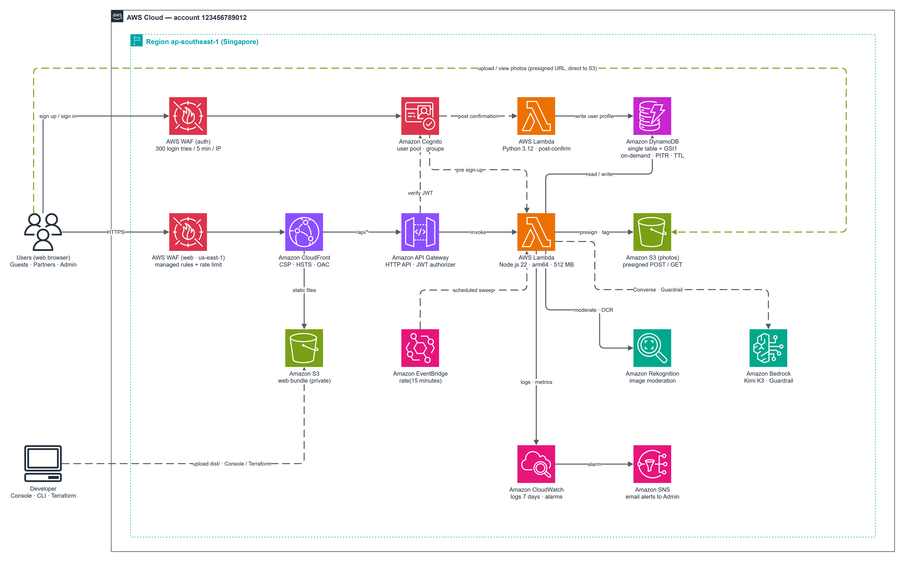

# Deploying and Securing the ReLoop Serverless Platform on AWS

### Workshop Overview

**ReLoop** is a platform that facilitates the trading and reuse of used or damaged electronic devices, connecting users with electronics buyers, repair shops, and recycling partners.

The project is developed by the **AWSS3nt1n4L** team during the First Cloud AI Journey (FCAJ) internship program. It uses a serverless architecture on Amazon Web Services (AWS), combined with artificial intelligence services to support device recognition, content moderation, and an improved user experience.

This workshop presents the process of building, integrating, securing, and testing the ReLoop system on AWS, covering the data layer, user authentication, image storage, API processing, web application delivery, system monitoring, and resource management.

In addition to the deployment process, the workshop focuses on the security mechanisms used throughout the system, including identity management, data protection, traffic control, AI content safety, and application monitoring.

### Workshop Objectives

- Understand serverless architecture and how AWS services are integrated into a practical web application.
- Explore the deployment of databases, user authentication, image storage, and Backend APIs.
- Understand security mechanisms using Amazon Cognito, AWS IAM, Amazon S3, Amazon CloudFront, and AWS WAF.
- Explore the use of Amazon Bedrock, Amazon Rekognition, and Bedrock Guardrails for content processing and moderation.
- Understand system monitoring, cost management, and business workflow testing.
- Understand resource cleanup and infrastructure management using Terraform.

{}
This workshop is based on the architecture, technical documentation, and deployment images of the ReLoop project, developed collaboratively by the AWSS3nt1n4L team. Illustrative configuration values should be adjusted to suit the participant's own AWS environment.
{}

---

### Workshop Contents

1. [ReLoop System Overview and Architecture](5.1-workshop-overview/)
2. [Environment Preparation and AWS Budget Management](5.2-prerequisites/)
3. [Building the Data Layer with Amazon DynamoDB](5.3-dynamodb/)
4. [Authentication and User Management with Amazon Cognito](5.4-cognito/)
5. [Image Storage and Protection with Amazon S3](5.5-s3-images/)
6. [Backend API Deployment with AWS Lambda and Amazon API Gateway](5.6-backend-api/)
7. [AI Content Moderation with Amazon Bedrock Guardrails](5.7-bedrock-guardrails/)
8. [Frontend Deployment with Amazon CloudFront and S3](5.8-cloudfront-frontend/)
9. [Web Application Protection with AWS WAF](5.9-waf/)
10. [Scheduled Task Automation with Amazon EventBridge](5.10-eventbridge/)
11. [System Monitoring with Amazon CloudWatch and SNS](5.11-monitoring/)
12. [End-to-End System Verification](5.12-end-to-end-verification/)
13. [Resource Cleanup and Infrastructure Management with Terraform](5.13-cleanup-and-iac/)

{}
Some AWS services may incur charges even when there is no incoming traffic. Monitor your budget throughout the workshop and remove unused resources after completing the exercises.
{}
