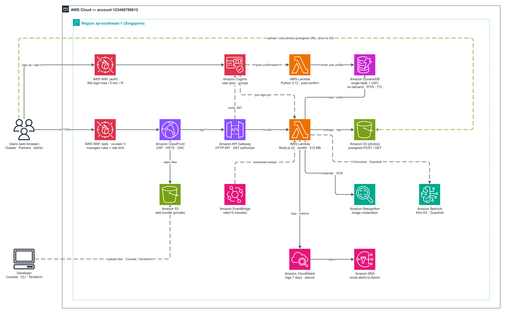

# Triển khai và bảo mật nền tảng ReLoop Serverless trên AWS

### Tổng quan bài thực hành

**ReLoop** là nền tảng hỗ trợ mua bán và tái sử dụng các thiết bị điện tử đã qua sử dụng hoặc bị hư hỏng, kết nối người dùng với các đối tác thu mua, sửa chữa và tái chế.

Dự án được xây dựng bởi nhóm **AWSS3nt1n4L** trong chương trình thực tập First Cloud AI Journey (FCAJ), sử dụng kiến trúc serverless trên Amazon Web Services (AWS) kết hợp các dịch vụ trí tuệ nhân tạo để hỗ trợ nhận diện thiết bị, kiểm duyệt nội dung và nâng cao trải nghiệm người dùng.

Workshop này trình bày quy trình xây dựng, tích hợp, bảo mật và kiểm thử hệ thống ReLoop trên AWS, từ tầng dữ liệu, xác thực người dùng, lưu trữ hình ảnh và xử lý API đến phân phối ứng dụng web, giám sát hệ thống và quản lý tài nguyên.

Bên cạnh quy trình triển khai, bài thực hành tập trung làm rõ các cơ chế bảo mật được sử dụng trong hệ thống, bao gồm quản lý danh tính, bảo vệ dữ liệu, kiểm soát lưu lượng truy cập, an toàn nội dung AI và giám sát hoạt động của ứng dụng.

### Mục tiêu bài thực hành

- Tìm hiểu kiến trúc serverless và cách tích hợp các dịch vụ AWS trong một ứng dụng web thực tế.
- Tìm hiểu quy trình triển khai cơ sở dữ liệu, xác thực người dùng, lưu trữ hình ảnh và Backend API.
- Tìm hiểu các cơ chế bảo mật với Amazon Cognito, AWS IAM, Amazon S3, Amazon CloudFront và AWS WAF.
- Tìm hiểu ứng dụng Amazon Bedrock, Amazon Rekognition và Bedrock Guardrails trong xử lý và kiểm duyệt nội dung.
- Tìm hiểu cách giám sát hệ thống, quản lý chi phí và kiểm thử các luồng nghiệp vụ.
- Nắm được quy trình dọn dẹp tài nguyên và quản lý hạ tầng với Terraform.

{}
Nội dung Workshop được xây dựng dựa trên kiến trúc, tài liệu kỹ thuật và hình ảnh triển khai của dự án ReLoop do các thành viên trong nhóm AWSS3nt1n4L phối hợp thực hiện. Các thông tin cấu hình minh họa cần được điều chỉnh phù hợp với môi trường AWS của người thực hành.
{}

---

### Nội dung Workshop

1. [Tổng quan và kiến trúc hệ thống ReLoop](5.1-workshop-overview/)
2. [Chuẩn bị môi trường và quản lý ngân sách AWS](5.2-prerequisites/)
3. [Xây dựng tầng dữ liệu với Amazon DynamoDB](5.3-dynamodb/)
4. [Xác thực và quản lý người dùng với Amazon Cognito](5.4-cognito/)
5. [Lưu trữ và bảo vệ hình ảnh với Amazon S3](5.5-s3-images/)
6. [Triển khai Backend API với AWS Lambda và Amazon API Gateway](5.6-backend-api/)
7. [Kiểm duyệt nội dung AI với Amazon Bedrock Guardrails](5.7-bedrock-guardrails/)
8. [Triển khai Frontend với Amazon CloudFront và S3](5.8-cloudfront-frontend/)
9. [Bảo vệ ứng dụng web với AWS WAF](5.9-waf/)
10. [Tự động hóa tác vụ định kỳ với Amazon EventBridge](5.10-eventbridge/)
11. [Giám sát hệ thống với Amazon CloudWatch và SNS](5.11-monitoring/)
12. [Kiểm thử hệ thống End-to-End](5.12-end-to-end-verification/)
13. [Dọn dẹp tài nguyên và quản lý hạ tầng với Terraform](5.13-cleanup-and-iac/)

{}
Một số dịch vụ AWS có thể phát sinh chi phí ngay cả khi không có lưu lượng truy cập. Cần theo dõi ngân sách trong quá trình thực hành và dọn dẹp các tài nguyên không còn sử dụng sau khi hoàn thành Workshop.
{}
